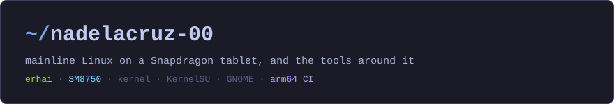

Daily driver is a OnePlus Pad 3 running Ubuntu on the [mainline port](https://github.com/TheMojoMan/oneplus-erhai-linux). Most repos here fix something on it, or build a tool missing for Linux aarch64. Everything is built on GitHub Actions and shipped as a release.

- **[erhai-gpu-lab](https://github.com/nadelacruz-00/erhai-gpu-lab)** · GPU runtime-PM test lab for the Adreno 830 GMU freeze. [Hang recovery patch](https://github.com/TheMojoMan/oneplus-erhai-linux/pull/9) open upstream.
- **[erhai-charging-lab](https://github.com/nadelacruz-00/erhai-charging-lab)** · USB-C charging test lab. Took the port from 25 W to [39 W](https://github.com/TheMojoMan/oneplus-erhai-linux/pull/2), then [50 W](https://github.com/TheMojoMan/oneplus-erhai-linux/pull/7) PPS charging, both merged.
- **[erhai-sleep-lab](https://github.com/nadelacruz-00/erhai-sleep-lab)** · Suspend/resume test lab with an on-device flight recorder.
- **[status-bar-guard](https://github.com/nadelacruz-00/status-bar-guard)** · KernelSU module. Per-app status bar and shade suppression for a Linux desktop on Android.
- **[magnetize](https://github.com/nadelacruz-00/magnetize)** · Magnet-style window snapping for GNOME, on any keyboard layout.
- **[aarch64-re-tools](https://github.com/nadelacruz-00/aarch64-re-tools)** · Ghidra natives and Rizin built for Linux aarch64.
- **[lig](https://github.com/nadelacruz-00/lig)** · Fork of the terminal autocomplete. [Zellij pane restore](https://github.com/KevenGoncalves/lig/pull/11) merged upstream.
